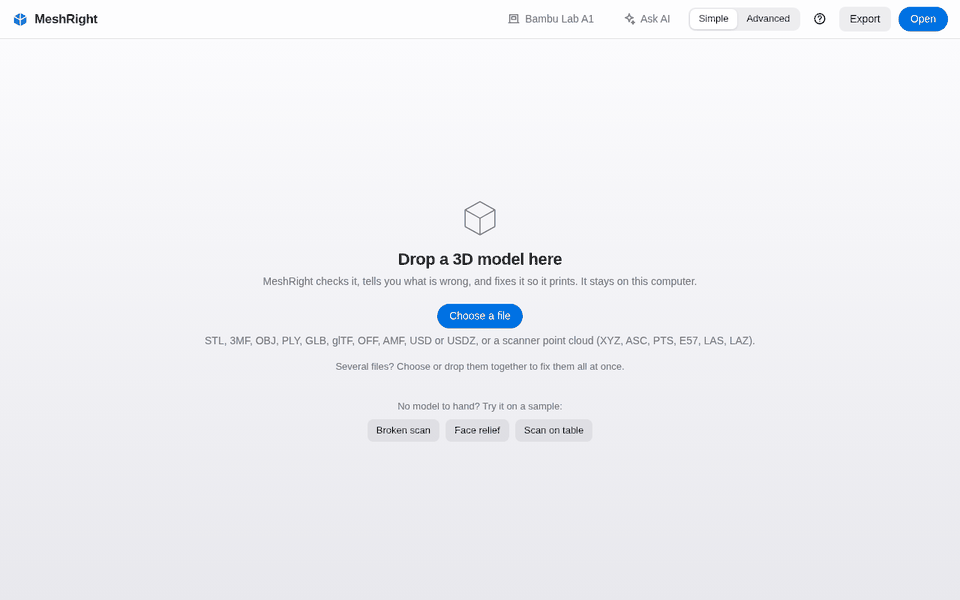
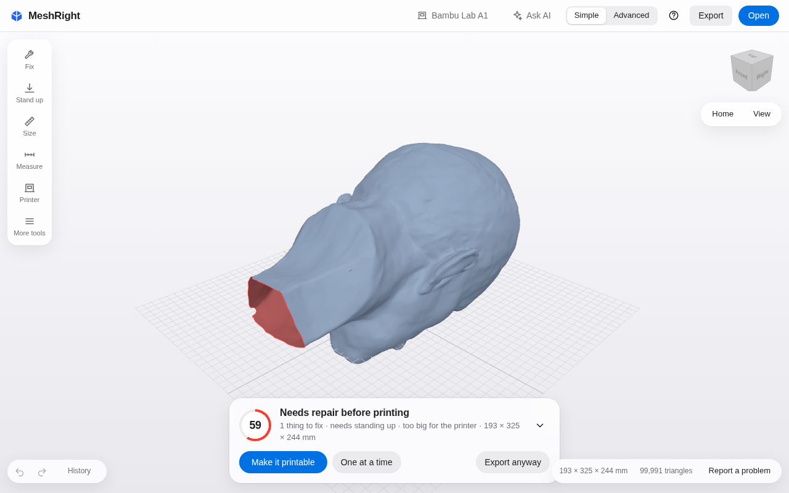
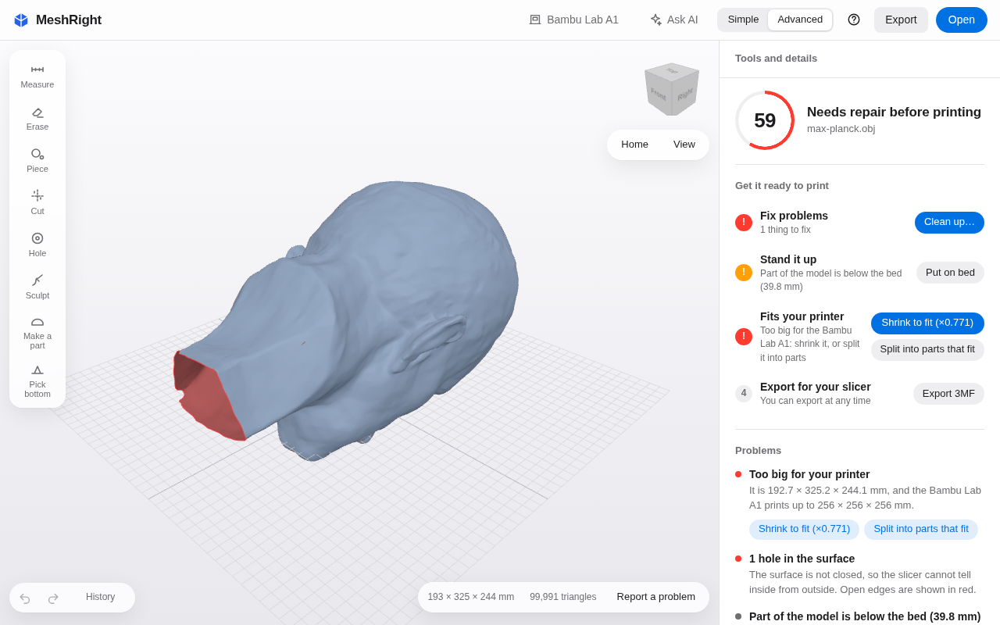
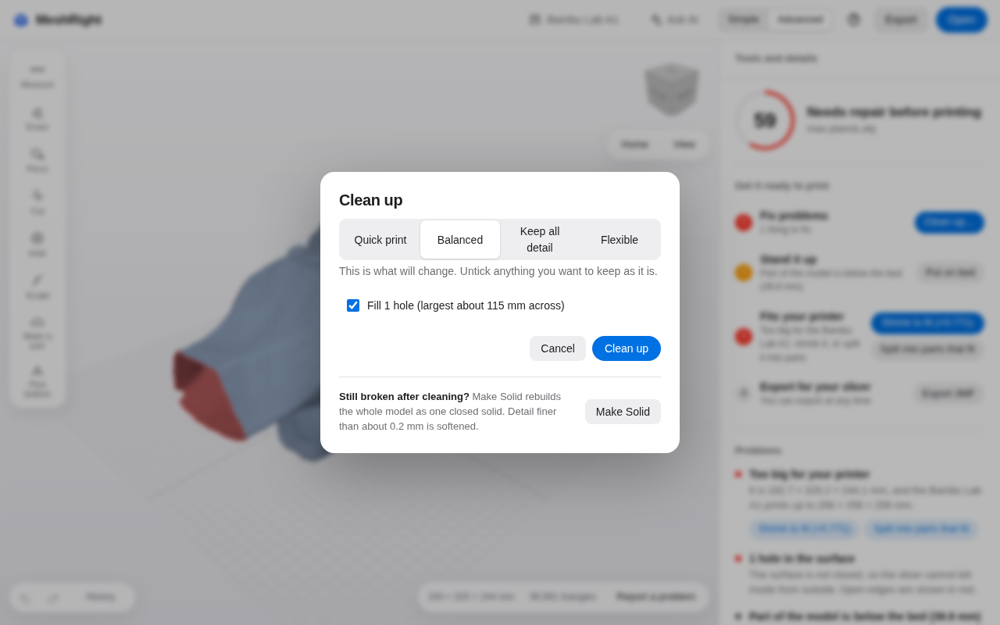

# MeshRight

**Check and fix 3D scans and models for printing. Free, simple, and on your own computer.**

MeshRight is a free, open source alternative to Meshmixer's repair tools
(Meshmixer is no longer developed). It is made for people who 3D print scans
and downloaded models and want one simple tool instead of several. It runs on
Windows, macOS and Linux, and opens in your web browser, but everything
happens on your own computer.



> **Status: early alpha.** Everything below works; expect rough edges.
> Please report problems with an example file.

## Start in 60 seconds

1. Download the app for your computer from the
   [Releases page](https://github.com/Huzy85/MeshRight/releases) and
   double-click it. MeshRight opens in your web browser.
2. Drop a model or scan onto the page, or click a sample model.
3. Press the blue button on the card at the bottom. It always does the next
   right thing: fix, stand it up, choose your printer, export. Press **?** at
   any time for help.

## In three steps

1. **Open** a scan or model. MeshRight checks it and gives it a score from 0
   to 100, with every problem explained in plain English and shown on the model.
2. **Follow the steps**: Fix problems, Stand it up, Fits your printer,
   Export for your slicer. Each step is one button, and every change can be
   undone. You can also step through the problems one at a time and skip any
   you want to keep.
3. **Print**: export a file, or open it straight in your slicer.

No settings to learn, no account, and your files never leave your computer.

**Simple or Advanced.** A switch at the top picks how much you see, and it is
remembered between visits. *Simple* shows one card with the score, one line
on what is wrong and one button. *Advanced* shows every tool and number in a
panel beside the model (drag it wider, or hide it with **T**), with the edit
tools on the left rail. A view cube in the corner turns the model like a
slicer does (keys 0 to 6 too).

| Simple: one card, one button | Advanced: every step and problem | Clean up shows its plan first |
|---|---|---|
|  |  |  |

## What it can do

**Check**
- Opens STL, 3MF, OBJ, PLY, GLB/glTF, OFF, AMF and USD (USDA, USDC, and
  USDZ as made by iPhone Object Capture), and turns point clouds (XYZ, ASC,
  PTS, E57, LAS, LAZ) into a surface. Wrong units and phone-scan orientation
  (metres, Y up) are fixed automatically. The downloaded app reads all of
  these except binary USD (USDC, and some USDZ), which needs a large extra
  reader: export those as OBJ, GLB or USDA, or see Install. FBX cannot be
  read; MeshRight says what to export instead.
- Says which scanner made a file (Revopoint, Creality, Shining 3D, Polycam,
  Scaniverse, KIRI, Luma and others) and what its scans usually need.
- A print-readiness score and a plain-English list of problems: holes, edges
  shared by too many triangles, surfaces cutting through themselves,
  inside-out parts, loose crumbs, walls too thin to print.
- Problems are shown on the model, plus a **Cut view**, an **Overhangs** view
  and a **Rough spots** view.
- **Show what changed**: after repairs, the model turns green where it is
  untouched and red where the surface moved, compared with your original file.

**Fix**
- **Clean up** in one click. It shows its plan first; choose Quick print,
  Balanced, Keep all detail or Flexible (for TPU, which then gets a stricter
  wall check).
- **Make Solid** rebuilds badly broken models as one closed solid.
- **Give it thickness** turns an open surface (a face scan, a mask) into a
  printable shell.
- **Sculpt** brushes: smooth rough spots, flatten, push out or in.
- A model saved in the wrong units (it opens a few millimetres across) is
  offered "Saved in inches / centimetres / metres" before anything else.

**Stand it up**
- **Which way is up?** offers pictures of likely bottoms; or click the bottom
  yourself.
- **Best way to print** compares placements for fewest supports, strongest
  part and fastest print.
- Warns when a model would tip over, and offers to cut the bottom flat or
  add a flat foot (which keeps the whole model).

**Fit your printer**
- Pick your printer once from a list, or enter its bed size.
- Too big? The checklist offers both: **shrink** it to fit, or **split** it
  into parts that fit, with pins so they line up when glued. **Cut in two**
  anywhere with a plane you slide.
- **Numbered parts**: each part's number is engraved on a cut face (hidden
  once glued), in assembly order, and MeshRight tells you which parts join.
- Show a **coin for scale** beside the model to picture its real size.

**Edit**
- Erase an area or a loose piece, drill holes, measure (and resize from a
  known distance), hollow for resin with drain holes.
- **Make a bust** from a head scan: closes the neck, cuts it flat, adds a base.
- **Make a part** that fits your scan (a pad, a grip, a cover).
- **Combine models**: join a stand or handle on, or cut a shape out.
- **Merge scans** taken from different sides into one model.

**Colours and export**
- Keeps colours from colour scans through every repair.
- **Print in colours** (Export, then *3MF in colours*): a 3MF painted for a
  multi-colour printer.
  MeshRight groups the scan's colours into 2 to 8 print colours and paints
  every triangle, so Bambu Studio, OrcaSlicer and PrusaSlicer open it ready
  to print. You only match each colour to a filament.
- Export STL, 3MF, OBJ or PLY, or **open it straight in** Bambu Studio,
  OrcaSlicer, PrusaSlicer, UltiMaker Cura or Creality Print.
- Save a project (.meshright) to carry on later.

**And**
- Up to four models open at once, in tabs (the oldest closes when you open a
  fifth). Files up to 1000 MB; very big files can be cancelled while they open.
- Fix many files at once, in the app or from the command line.
- **Ask AI** (optional): connect any AI service you already use, or a free
  one on your own computer, and ask about your model in plain words. See
  [Ask AI](#ask-ai).
- Works with AI apps: `meshright mcp` offers the checks, Clean up and every
  action to Claude Desktop, Claude Code, Cursor and other MCP apps (see Use).
- Sample models, a searchable help guide of 45 topics, a tooltip on every
  control, and keyboard shortcuts (press **?**).
- **Your work survives a crash**: after every step the open model is saved in
  the settings folder (the newest 10 are kept), so you can reopen it.
- **Report a problem** (bottom-right corner) collects the recent error
  messages, your steps, the version and your system into a zip in Downloads
  and opens an email for you to send. Your model is only included if you tick
  the box. Nothing is sent unless you send that email.
- Runs on your own computer and works offline. The only thing it asks the
  internet is GitHub's latest version number, once a day (you can switch
  that off).

**Extra tools for AI apps and scripts (not in the browser yet)**

These are new in 0.3.0 and can be used through `meshright mcp` (see Use) or
the app's API. They will get buttons in the browser later.

- **Scan to print**: one step that removes the scan table, smooths, reduces
  detail, cleans up and makes a closed solid.
- **Smooth scan** (light, medium or heavy) without shrinking the model, and
  **Remove base** to cut away the flat table a scan was standing on.
- **Fill curved holes** with a patch that follows the surface, **Repair
  wound** for a broken-off area whose piece is lost, and **Seam polish** for
  rough joins.
- **Symmetry repair**: finds the mirror plane of a part that should be
  symmetric and rebuilds the broken side from the good one.
- **Photo-guided repair**: match four or more points between a photo of the
  intact part and the scan, and missing areas the photo shows are filled.
- **Even out triangles** (remesh), a **curvature map** and a **deviation map**
  against another scan.
- **Molds**: check whether a part can be cast, then make a two or three piece
  mold with a pour hole, air vents, alignment pins, bolt holes and optional
  printable clamps.

## Ask AI

MeshRight works fully without AI. If you want, you can connect an AI service
and ask questions such as "why won't this print?" or "make it 15 cm tall and
fix it". Click **Ask AI** at the top of the page. The first time, choose a
service:

- **On your own computer, free:** Ollama or LM Studio. Install one, download a
  model (for example `qwen3:8b` in Ollama), and choose it in MeshRight. No key
  needed and nothing leaves your computer.
- **A service you pay for:** OpenAI, Claude (Anthropic), Google Gemini,
  OpenRouter, DeepSeek, Mistral or Groq. Paste your API key from that
  service's website.
- **Anything else** that speaks the OpenAI chat format: choose *Other* and
  type its address.

What the AI can do:

- Explain the check report in plain words and answer questions about it.
- Suggest steps from MeshRight's own tools, such as Clean up, Set size,
  Put on bed, Hollow or Make a bust. You see each step with its reason and
  tick the ones you want. **Nothing changes until you press Apply**, and each
  step shows in the history and can be undone.

What it cannot do:

- See your model. It is sent the check report (score, sizes, the list of
  problems), your printer settings and your question, never the model file.
- Use the tools that need you to click on the model (erase an area, sculpt,
  merge scans). It tells you when you need one of those.
- Change anything by itself, or invent tools: any step that is not a real
  MeshRight tool with sensible settings is dropped before you see it.

Your key is stored only on this computer, in a settings file only your user
account can read, and is never shown in the page again. **Forget** in AI
settings deletes it. You can also leave it out of the file and set the
`MESHRIGHT_AI_KEY` environment variable instead.

From the command line:

```bash
meshright ask model.stl "will this print on my printer?"
meshright ask model.stl "make it 50 mm tall" --provider ollama --model qwen3:8b
```

## Install

**Easiest:** download the app for your computer from the
[Releases page](https://github.com/Huzy85/MeshRight/releases):
`MeshRight-windows.exe`, `MeshRight-macos` or `MeshRight-linux`.
Double-click it and MeshRight opens in your web browser. Nothing else to
install. The app includes the E57 and LAS/LAZ readers and the AI-app (MCP)
server.

> The apps are not signed yet. On Windows choose *More info*, then *Run
> anyway*. On a Mac, right-click the file and choose *Open* the first time. On
> Linux, allow the file to run as a program (right-click, Properties,
> Permissions).

**With Python** (3.10 or newer):

```bash
pip install meshright
```

Optional extras, in square brackets: `e57` (E57 scans), `las` (LAS and LAZ
scans), `usd` (binary USD, a large download), `mcp` (AI apps). For example:

```bash
pip install "meshright[e57,las,mcp]"
```

To run the latest code from this repository instead:

```bash
git clone https://github.com/Huzy85/MeshRight.git
cd MeshRight
pip install .
```

**Needs:** Windows 10 or newer, macOS 12 or newer, or a recent Linux, on a
64-bit computer. 8 GB of memory handles most scans; very big scans (several
million triangles) want 16 GB. Any modern browser. The apps are built for
Intel and AMD processors and Apple Silicon Macs; ARM Windows and ARM Linux are
untested.

## Use

Open the app in your browser:

```bash
meshright
```

Options for the app:

```bash
meshright serve --port 8766      # use another port if 8765 is busy
meshright serve --no-browser     # start without opening a browser window
```

`--host 0.0.0.0` lets other devices on your network open MeshRight. There is
no password, so only do this on a network you trust, and list the names they
will use in `MESHRIGHT_ALLOWED_HOSTS` (comma-separated). Anyone who can reach
it can also use your Ask AI connection. `MESHRIGHT_MAX_UPLOAD_MB` changes the
1000 MB file limit.

Check files or whole folders from the command line:

```bash
meshright check model.stl other_model.3mf
meshright check scans/
meshright check model.stl --json
```

`meshright check` exits with code 1 when any file needs repair, so it can be
used in scripts.

Fix a whole folder (the fixed files and a report go into `meshright-fixed`):

```bash
meshright fix scans/
meshright fix scans/ --format stl --best-bottom
```

**Let an AI app use MeshRight.** MeshRight is an MCP server, so Claude
Desktop, Claude Code, Cursor and other MCP apps can check a file, run Clean up
or any single action, export a colour scan painted for a multi-colour printer,
and read your printer settings, all on your own computer. Print the settings
to paste:

```bash
meshright mcp --show-config
```

It prints the lines and says where they go for each app (for Claude Desktop:
Settings, Developer, Edit Config). From the downloaded app, run the same
command against the app file, for example `MeshRight-windows.exe mcp
--show-config`. The AI app writes its results next to your file, or where it
is told to. It will not replace an existing file unless it passes
`overwrite`, and it never replaces the original.

## Troubleshooting

- **The browser does not open.** Go to http://127.0.0.1:8765 yourself.
- **"Port 8765 is busy".** MeshRight may already be running in another
  window. Close it, or start with `meshright serve --port 8766`.
- **Windows says it protected your PC.** The app is not signed yet. Choose
  *More info*, then *Run anyway*.
- **macOS says the app cannot be opened.** Right-click it and choose *Open*.
- **A big scan is slow.** Use *Reduce detail* first. Above about 3 million
  triangles every change takes a while.
- **Hollow says some pockets could not be drained.** A closed pocket inside
  the model has no way out for resin. Cut the model in two, or add a hole
  yourself with *Add a hole*, then hollow again.
- **An FBX or binary USD file will not open.** Export it as OBJ, GLB or STL
  from the app that made it (Blender: File, Export).
- **Something else went wrong.** Your model is never changed by a failed
  step. Please [report it](https://github.com/Huzy85/MeshRight/issues) with
  the file if you can.

## Privacy

Everything happens on your own computer. MeshRight has no account and no
tracking. It contacts the internet for two things only: GitHub's latest
version number, once a day (switch it off in Help), and, only if you set it
up, the AI service you chose in Ask AI, which receives the check report and
your question, never the model. Report a problem only opens an email in your
own mail app; you see it and choose whether to send it.

## Words used

- **Triangle**: models are made of thousands of small flat triangles joined
  edge to edge.
- **Hole**: a gap where triangles are missing. Printers need a closed surface.
- **Slicer**: the program that turns a model into instructions for your
  printer (Bambu Studio, PrusaSlicer, Cura and others).
- **Support**: extra plastic printed under overhanging parts and removed
  afterwards.

## What's new

See [CHANGELOG.md](CHANGELOG.md).

## Contributing

Contributions are welcome, from bug reports with example files to new repair
tools. See [CONTRIBUTING.md](CONTRIBUTING.md).

## Licence

MeshRight is free software under the [GNU GPL v3](LICENSE). In plain words:
you can use it for anything, including models you sell, and share it freely.
If you share a changed version of MeshRight itself, you must share its source
code under the same licence. The bundled [three.js](https://threejs.org)
library is MIT licensed.
